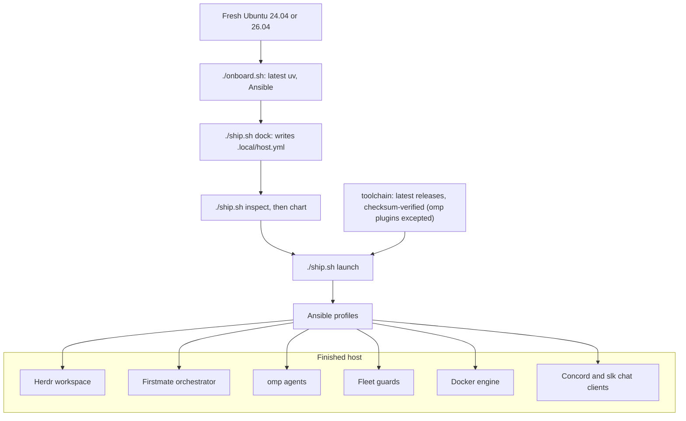

<div align="center">

# 🚢 Crewship

**Set up a VPS and orchestrate hundreds of agents effortlessly - hardware is the limit.**

[](https://github.com/i098/Crewship/actions/workflows/ci.yml)
[](https://github.com/i098/Crewship/releases/latest)
[](LICENSE)
[](https://github.com/i098/Crewship/stargazers)
[](https://github.com/i098/Crewship/commits/main)

[Docs](#docs) · [Install](#quick-start) · [Changelog](CHANGELOG.md) · [Discussions](https://github.com/i098/Crewship/discussions)


*A finished host: Herdr lists the workspaces and agents on the left, and omp agents work side by side.*

</div>

Crewship makes it super easy to start using agents in the cloud.

## Features

- **[Firstmate orchestration](docs/architecture.md#agent-fleet-and-supervision):** one supervisor agent runs many coding agents.
- **[Custom Herdr sidebar](docs/herdr.md):** every workspace and agent, with its state and load, at a glance.
- **[In-memory message board](docs/board.md):** agents on one host talk over topics that never touch disk (opt-in).
- **[Guards](docs/fleet-guards.md):** block `pkill`, gate quality, and clean up stray containers and dev servers.
- **[Browser ladder](docs/fleet-guards.md#browser-ladder):** a light browser first, full Chrome or noVNC only when needed (opt-in).
- **[Chat clients](docs/chat.md):** Discord, Slack, and [iMessage](docs/imessage.md) from the terminal.
- **[Credential management](docs/secrets.md):** one `super.env` file, fetched by each new host through a private Worker.
- **[Mac control](docs/security.md#ssh-to-a-mac):** agents run `ssh mac` to open links and control apps on your Mac (opt-in).

<details>
<summary><b>Show all features</b></summary>

- [omp agents](docs/omp.md): sign-in, model roles, fallbacks, and the advisor
- [Shared Postgres](docs/shared-postgres.md): one container, per-project databases and worktree connection strings (opt-in)
- [Capacity and auto pruners](docs/capacity.md): host sizing per lane count, and cleanup timers
- [Data disk](docs/configuration.md#data-disk): Docker and the npm and pip caches on a second disk (opt-in)
- [Self-hosted CI pool](docs/ci-pool.md): GitHub Actions runners, one job per fresh container (opt-in)
- [GitHub board](docs/github-board.md): agent work as issues on a Project board (opt-in)
- [Host-move checklist](docs/configuration.md#new-host-questions): new-host questions that follow your own checklist (opt-in)
- [Google Workspace CLI](docs/google-workspace.md): `gws` with several Google accounts on a headless host
- [herdr-patch](herdr-patch/README.md): Herdr over mosh with real images
- [Checksum-verified toolchain](docs/dependencies.md): every tool, package, and image the recipe installs
- [Neovim with LazyVim](docs/dependencies.md#neovim-and-lazyvim): a terminal editor on every host, with Pyrefly for Python
- [Install, update and migrate](docs/install.md): release artifact, updates, moving a git install
- [Migration and recovery](docs/recovery.md): new-device sequence, desktop access, upgrades
- [Review desktop](docs/recovery.md#desktop-access): XFCE through loopback noVNC (opt-in)
- [Tailscale](docs/security.md#remote-access): the Tailscale daemon for remote access (opt-in)
- [Agent host move](docs/agent-host-move.md): move the agents to a new host with parity checks
- [Security](docs/security.md): credential handling and remote access
</details>

<details>
<summary><b>Default config</b></summary>

- **Models:** [omp](docs/omp.md) runs the agents. Opus 5.5 at extra-high thinking runs the home, with the advisor off. Firstmate picks a model for each task: Haiku 5.5 or Luna for small work, Sonnet 5.5 or Sol 6.1 for ordinary work (the default), and Opus 5.5 for hard work only. The spawning agent picks the thinking level.
- **Fallbacks:** a model that keeps failing falls back to the next one. Opus 5.5 falls back to Fable 5.1 at medium thinking, Fable 5.1 to Opus 5, and Sonnet 5 to Fable 5.1, then Opus 5.
- **Plugins and extensions:** the omp plugins `ponytail`, `i-have-adhd`, and `caveman`. Extensions add the [turn-end quality check](docs/omp.md#quality-gate), [status-line icons](docs/omp.md#status-line-icons), the [Herdr sidebar](docs/herdr.md) feed, and a block on kill-by-name commands such as `pkill` and `killall`.
- **Gates:** the [no-mistakes pipeline](docs/omp.md#no-mistakes-pipeline-agent) and `ponytail-review` check every change. Gates use Sonnet 5.5 at high thinking, and Opus 5.5 for hard work. Pick another model for one run with `--model`.
- **Skills and rules:** [`skills/`](skills/) and [`config/AGENTS.md`](config/AGENTS.md) serve omp, Claude Code, and Codex. Public files install with the `agents` profile, and private files take precedence ([omp](docs/omp.md#skills)). The [rules](docs/omp.md#rules) set plain technical writing, always-on skills, and native stacked PRs.
- **Profiles on by default:** `agents`, `development`, `firstmate`, `docker`, `chat`
- **Opt-in profiles:** `tailscale`, `desktop`, `fleet_guards`, `shared_postgres`, `fleet_browsers`
- **Opt-in settings:** `data_dir`, `firstmate.checklist`, `mac_ssh`, `imessage`, `github_board`, `board`, `ci_pool`
- **Full lists:** [`config/default.yml`](config/default.yml), [`config/omp.yml`](config/omp.yml), and the [wiki](https://github.com/i098/Crewship/wiki).

</details>

## How it works



## Quick start

### Get a machine

Buy an Ubuntu 24.04 or 26.04 server from any VPS or cloud provider, for example [Hetzner Cloud](https://www.hetzner.com/cloud/), [OVHcloud VPS](https://www.ovhcloud.com/en/vps/), or [DigitalOcean Droplets](https://www.digitalocean.com/products/droplets). A spare machine at home works too.

Runs on 4 vCPU / 16 GB and up; a 96 vCPU / 247 GB host ran 37 agents in about 67 GB RAM ([Capacity](docs/capacity.md)).

### Set up

Paste this into your coding agent or `omp` on the machine. It installs Crewship and sets it up with you:

```text
Set up Crewship on this machine by following https://github.com/i098/Crewship/blob/main/SETUP.md
```

Prefer to do it by hand? The installer commands are in [SETUP.md](SETUP.md); the [wiki](https://github.com/i098/Crewship/wiki) has the rest.

## More docs

- [Architecture](docs/architecture.md)
- [Contributing](CONTRIBUTING.md)
- [Support](SUPPORT.md)
- [Report a bug](../../issues/new?template=bug_report.yml)
- [Request a feature](../../issues/new?template=feature_request.yml)
- [Pull request template](.github/PULL_REQUEST_TEMPLATE.md)
- [Security](SECURITY.md)
- [Code of conduct](CODE_OF_CONDUCT.md)
- [License: FSL-1.1-Apache-2.0](LICENSE)

## Built with

Built on Herdr, Firstmate, omp, Ansible and more: see [CREDITS.md](CREDITS.md).

## Sponsors

If Crewship saves you time, sponsor its development on GitHub.

<a href="https://github.com/sponsors/i098"></a>

<!-- The sponsors workflow writes the sponsor list between these markers; the line below is FALLBACK in scripts/sponsors.py. -->
<!-- sponsors -->
No sponsors yet. Be the first, and your name goes here.
<!-- /sponsors -->

## Star history

<a href="https://star-history.com/#i098/Crewship&Date">
  <picture>
    <source media="(prefers-color-scheme: dark)" srcset="https://api.star-history.com/svg?repos=i098/Crewship&type=Date&theme=dark">
    <source media="(prefers-color-scheme: light)" srcset="https://api.star-history.com/svg?repos=i098/Crewship&type=Date">
    
  </picture>
</a>
