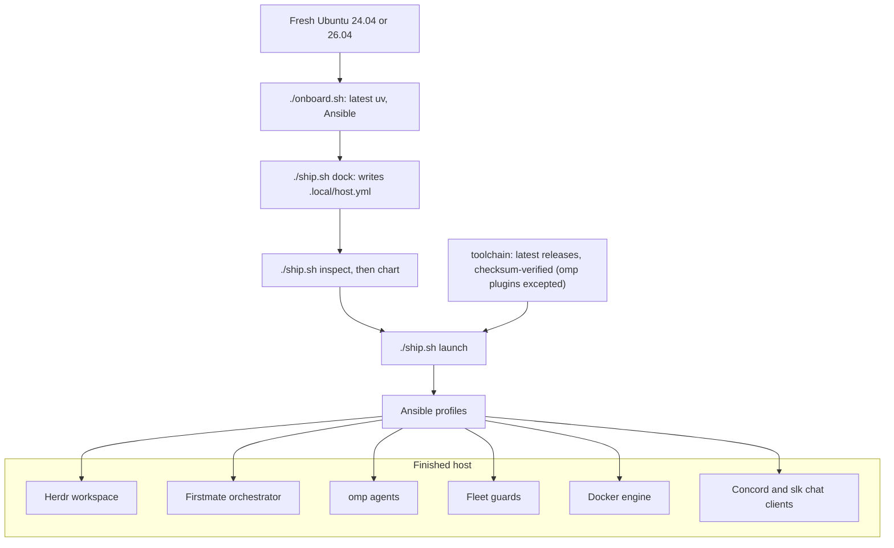

<div align="center">

# 🚢 Crewship

**Set up a VPS and orchestrate hundreds of agents effortlessly - hardware is the limit.**

[](https://github.com/i098/Crewship/actions/workflows/ci.yml)
[](https://github.com/i098/Crewship/releases/latest)
[](LICENSE)
[](https://github.com/i098/Crewship/stargazers)
[](https://github.com/i098/Crewship/commits/main)
[](https://github.com/sponsors/i098)

[Docs](#more-docs) · [Install](#quick-start) · [Changelog](CHANGELOG.md) · [Discussions](https://github.com/i098/Crewship/discussions)


*A finished host: Herdr lists the workspaces and agents on the left, and omp agents work side by side.*

</div>

Crewship makes it super easy to start using agents in the cloud.

## Features

- **[Firstmate orchestration](docs/architecture.md#agent-fleet-and-supervision):** one supervisor agent runs many coding agents.
- **[Custom Herdr sidebar](docs/herdr.md):** every workspace and agent, with its state and load, at a glance.
- **[In-memory message board](docs/board.md):** agents on one host talk over topics that never touch disk (opt-in).
- **[Guards](docs/fleet-guards.md):** block `pkill`, gate quality, and clean up stray containers and dev servers.
- **[Browser ladder](docs/fleet-guards.md#browser-ladder):** a light browser first, full Chrome or noVNC only when needed (opt-in).
- **[Chat clients](docs/chat.md):** Discord, Slack, and [iMessage](docs/imessage.md) from the terminal.
- **[Credential management](docs/secrets.md):** one `super.env` file, fetched by each new host through a private Worker.
- **[Mac control](docs/security.md#ssh-to-a-mac):** agents run `ssh mac` to open links and control apps on your Mac (opt-in).

The other features, each with its docs link, are listed in [docs/features.md](docs/features.md).

## Quick start

### Get a machine

Buy an Ubuntu 24.04 or 26.04 server from any VPS or cloud provider, for example [Hetzner Cloud](https://www.hetzner.com/cloud/), [OVHcloud VPS](https://www.ovhcloud.com/en/vps/), or [DigitalOcean Droplets](https://www.digitalocean.com/products/droplets). A spare machine at home works too.

Runs on 4 vCPU / 16 GB and up; a 96 vCPU / 247 GB host ran 37 agents in about 67 GB RAM ([Capacity](docs/capacity.md)).

### Set up

Paste this into your coding agent or `omp` on the machine. It installs Crewship and sets it up with you:

```text
Set up Crewship on this machine by following https://github.com/i098/Crewship/blob/main/SETUP.md
```

Prefer to do it by hand? The installer commands are in [SETUP.md](SETUP.md); the [wiki](https://github.com/i098/Crewship/wiki) has the rest.

## How it works

The services, agents and guards on a host, and how they connect: [Architecture](docs/architecture.md).




## More docs

- [Architecture](docs/architecture.md)
- [Contributing](CONTRIBUTING.md)
- [Support](SUPPORT.md)
- [Report a bug](../../issues/new?template=bug_report.yml)
- [Request a feature](../../issues/new?template=feature_request.yml)
- [Pull request template](.github/PULL_REQUEST_TEMPLATE.md)
- [Security](SECURITY.md)
- [Code of conduct](CODE_OF_CONDUCT.md)
- [Default config](docs/default-config.md)

## Built with

Built on Herdr, Firstmate, omp, Ansible and more: see [CREDITS.md](CREDITS.md).

## Star history

<a href="https://star-history.com/#i098/Crewship&Date">
  <picture>
    <source media="(prefers-color-scheme: dark)" srcset="https://api.star-history.com/svg?repos=i098/Crewship&type=Date&theme=dark">
    <source media="(prefers-color-scheme: light)" srcset="https://api.star-history.com/svg?repos=i098/Crewship&type=Date">
    
  </picture>
</a>
