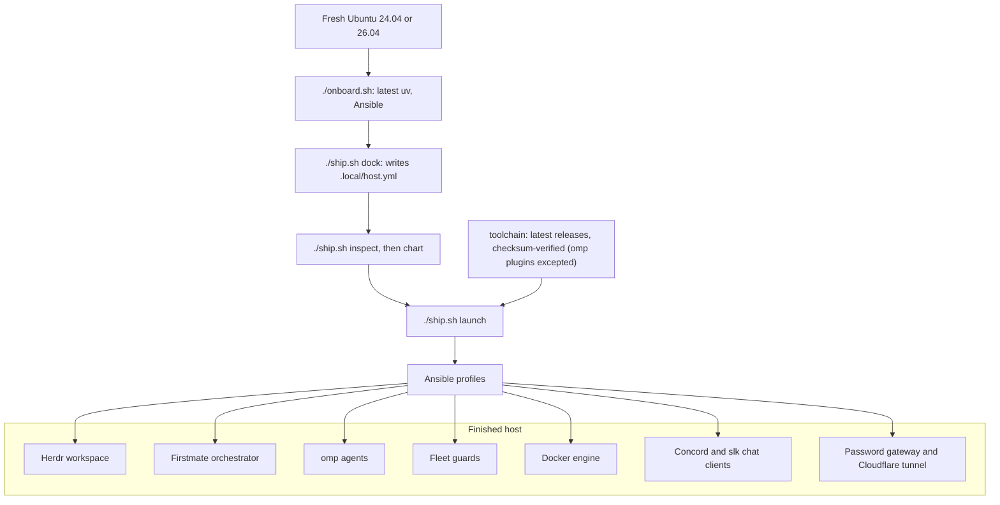

# Set up Crewship (for an AI agent)

You are an AI agent. A user has a fresh Ubuntu machine and asked you to set up Crewship on it. Do the steps below in order. Run each command yourself. Stop and ask the user where a step says STOP. Never guess a login, a code, or a choice.

You need Ubuntu 24.04 or 26.04 with systemd, and a non-root account that has sudo. Check with `lsb_release -rs`, `id -u` (not 0), and `sudo -n true`. If the machine does not fit, STOP and tell the user.

Report each result to the user in one line. If a command fails, show its last lines, then fix it or ask. Do not skip a step to hide a failure.

## Setup flow



## 0. Install Crewship

```bash
curl -fsSL https://raw.githubusercontent.com/i098/Crewship/main/install.sh | bash
```

`bunx crewship` does the same when bun is installed; `npx crewship` and `pnpm dlx crewship` work too. Do not clone the repository.

The installer installs the OS packages, downloads and verifies the latest release into `~/Crewship`, and runs `onboard.sh`, `ship.sh dock`, `inspect`, `chart`, and `launch` with the default profiles ([Install, update and migrate](docs/install.md)). The later steps sign in and change the profiles, then apply again.

- STOP: if `sudo` asks for a password, the user must type it in the terminal. Never store or echo it.
- Check: `ls ~/Crewship/ship.sh ~/Crewship/.local/host.yml` lists both files, and the installer ended without an error.
- STOP: the installer's output ends with the web address ([Web pages from anywhere](docs/gateway.md)). Give the user only that address. Tell the user to get the password without you: read `~/.config/crewship/gateway/initial-password` over SSH, or run `crewship-gateway password` in their own terminal. Never read, print, or relay the password.
- Then run `cd ~/Crewship` for every later step.

## 1. Sign in to GitHub

```bash
gh auth status
```

- If it says you are logged in, go to step 2.
- Otherwise run `gh auth login`.
- STOP: the user must choose the options and finish the browser or device-code step. Show the one-time code and the URL that `gh` prints. Wait until the user says the login is done.
- Check: `gh auth status` prints a logged-in account.

## 2. Sign in to omp

omp is the agent harness. Crewship needs a provider login ([Sign in](docs/omp.md#sign-in)).

```bash
omp models --json
```

- If the output lists models, a login exists. Go to step 3.
- Otherwise start `omp`, and ask the user which provider they use. For Anthropic, type `/login anthropic`. `/login` with no argument lists every provider.
- STOP: the user must finish the browser or device-code step. Show the URL or code that omp prints. Wait until the user says it is done.
- Check: `omp models --json` lists at least one model. Never copy a credentials file from another host.

## 3. Choose profiles with the user

`.local/host.yml` holds the host config. Open it and show the user the `profiles` block. The defaults are:

| Profile | Default | Adds |
| --- | --- | --- |
| `agents`, `development`, `firstmate`, `docker`, `chat` | on | omp, build tools, the Firstmate orchestrator, Docker, Discord and Slack terminal clients |
| `gateway` | on for a new host | one password for the host's web pages over a Cloudflare Quick Tunnel ([Web pages from anywhere](docs/gateway.md)); a host from before the gateway keeps it off until `profiles.gateway: true` is set |
| `fleet_guards` | off | Docker guard, dev-server reaper, storage guard, browser ladder |
| `shared_postgres` | off | one shared Postgres container for many projects |
| `fleet_browsers` | off | the browser ladder only |
| `tailscale` | off | the Tailscale daemon (login is manual); an option beside the gateway |
| `desktop` | off | a loopback-only XFCE desktop over noVNC |

The full list and the rules between profiles are in [Profiles](docs/configuration.md#profiles).

- STOP: ask the user which profiles to turn on. Change only the keys the user chose, with `true` or `false`.
- Never put secrets, host names, or personal details in `.local/host.yml` that the user did not give you.
- Check:

```bash
./ship.sh inspect
```

It must print no error. If it names a key, fix that key and run it again.

## 4. Preview the change

```bash
./ship.sh chart
```

This runs Ansible in check mode and changes nothing. Tell the user what it would change, in a few lines.

- STOP: ask the user to approve the launch.

## 5. Apply again

The installer already applied the default profiles. This run applies your changes and the new sign-ins.

```bash
./ship.sh launch
```

- It may ask for the sudo password. STOP and let the user type it. Never store or echo it.
- Run it in an interactive terminal. With the `firstmate` profile on and omp signed in, the first launch then opens omp with the new-host questions ([New-host questions](docs/configuration.md#new-host-questions)). Relay each question to the user and pass on the answer.
- If omp was not signed in at the first launch, the questions are skipped. Run `./ship.sh launch` again after step 2.
- Check: the command ends with no failed task. A second `./ship.sh launch` reports `changed=0`.

## 6. Verify and report

```bash
./ship.sh survey
```

- Check: each expected tool runs, and `gh` shows as authenticated.
- Check: `crewship-gateway url` prints an `https://….trycloudflare.com` address, unless the user turned the gateway off.
- Tell the user what passed and what failed, and which step to repeat for each failure.
- Do not mark the setup as done while a check fails.

## Where to look when stuck

- [Configuration](docs/configuration.md): commands, profiles, and the host config
- [Migration and recovery](docs/recovery.md): new devices and upgrades
- [Security](docs/security.md): what you must never copy or export
