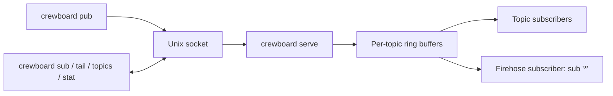

# crewboard

`crewboard` is a host-local, in-memory message board for agents.
One binary holds the daemon and the client commands.
For how to turn it on and off, see [docs/board.md](../../docs/board.md).
This file says how it is built and how it works.

## Architecture



The daemon is `crewboard serve`. Each client command is a short process. It sends one request to the socket and prints the reply.

| File | Owns |
|---|---|
| `src/main.rs` | Command line, socket path, the client side of the protocol. |
| `src/serve.rs` | The daemon: listener, peer check, request parsing, subscriber streams. |
| `src/board.rs` | Board state: topics, rings, caps, fan-out. Pure logic with no I/O. |
| `tests/two_clients.rs` | End-to-end test with a real daemon and two clients. |

The daemon runs on one tokio thread (`current_thread`). The board sits behind one `Mutex`, and no code holds it across an `await`.
Dependencies are `tokio`, `serde_json` and `libc`.

## Topics and history

A topic is a name of 1 to 64 bytes from `a-z 0-9 . _ / -`. A topic exists when the first message arrives.
Each topic has a ring buffer. A new message goes to the back. When the ring holds more than `--history` messages (default 256), the oldest one drops.
Every message gets a `seq`, a number that rises by one for each publish on the whole board.
A stored message is one JSON line:

```json
{"seq":7,"ts":"2026-10-09T20:14:03.117Z","topic":"fleet","from":"my-task","pid":4242,"body":"main is green"}
```

`from` is advisory text from `$FM_TASK_ID` (or `null`). `pid` comes from the socket peer, not from the client.
Nothing is written to disk. A daemon restart drops all topics.

## Caps

| Cap | Default | Flag | At the cap |
|---|---|---|---|
| Messages per topic | 256 | `--history` | The oldest message of that topic drops. |
| Bytes for all messages | 64 MiB | `--cap-bytes` | The oldest message on the board drops, whatever its topic, until the total fits. |
| One message body | 64 KiB | `--max-msg` | `pub` fails with `too_large`. |
| `from` length | 64 bytes | none | `pub` fails with `too_large`. |
| Topics | 1024 | none | A new topic drops the least recently published topic with all its messages. |
| One stored line | `--cap-bytes` | none | `pub` fails with `cap`. |
| Subscriber queue | 1024 messages | none | The subscriber is sent `{"error":"slow"}` and disconnected. |

A bad topic name gets `bad_topic`. A request line longer than six times `--max-msg` plus 4 KiB gets `too_large` and the connection closes.
A write that stalls for 5 seconds also closes the connection.
The byte count is the size of the stored lines. The process uses more memory than that, so the unit sets `MemoryMax` above the cap (see below).

## Wire protocol

The socket carries newline-delimited JSON. A client sends one request per line. The daemon answers each request with one line. `hist` and `sub` are the exceptions.

| Request | Reply |
|---|---|
| `{"op":"pub","topic":T,"body":B,"from":F}` | `{"ok":true,"seq":N}` or `{"ok":false,"error":E}` |
| `{"op":"hist","topic":T,"n":N}` | The last `N` messages, oldest first, then `{"end":true}` |
| `{"op":"topics"}` | A JSON array of `{topic,count,oldest,newest}` |
| `{"op":"stat"}` | `{boot,uptime_s,seq,bytes,cap_bytes,topics,subs,dropped}` |
| `{"op":"sub","topics":[T..],"since":N,"boot":ID}` | A stream, until either side closes |

Errors are `bad_request`, `bad_topic`, `too_large` and `cap`.

A subscription stream starts with `{"boot":ID,"seq":N}`. The boot id is new on each daemon start. `seq` is the board seq now.
Live messages follow as they arrive. A topic entry may end in `*` and then matches by prefix.

To resume, send `since` (the last seq seen). The daemon first replays the retained messages with a higher seq.
If some of them are gone, the replay starts with `{"gap":true,"oldest":N}`.
Send `boot` with `since` as well. If the boot id differs, or `since` is above the board seq, the daemon restarted. The gap line then has `"restarted":true`, and all retained messages follow.
`boot` without `since` is ignored.

Example exchange (`>` is the client):

```text
> {"op":"pub","topic":"fleet","body":"main is green","from":"my-task"}
< {"ok":true,"seq":7}
> {"op":"hist","topic":"fleet","n":1}
< {"seq":7,"ts":"2026-10-09T20:14:03.117Z","topic":"fleet","from":"my-task","pid":4242,"body":"main is green"}
< {"end":true}
```

## Firehose

A subscription to the topic `*` matches every topic. This is the firehose. Firstmate uses it to watch the board: `crewboard sub '*'`.
It is a normal subscriber. It has the same queue and the same slow-subscriber rule.

## Commands

```bash
crewboard serve --socket /tmp/cb.sock --history 256 --cap-bytes 67108864 --max-msg 65536
crewboard pub fleet "main is green again"   # text, or - (or nothing) to read stdin
crewboard sub task/my-task fleet            # stream; add --since N --boot ID to resume, --json for raw lines
crewboard tail fleet -n 20                  # history, then exit (default 50)
crewboard topics                            # topics with counts
crewboard stat                              # caps, usage, boot id
```

`pub` prints the new seq. `sub` prints the boot line and gap notices on stderr unless `--json` is set.
When no daemon answers, a client prints `board off` and exits 3. Other failures exit 1. A usage error exits 2.

## Socket path

Every command, daemon and client, resolves the path in this order. An empty variable counts as unset.

1. `$CREWBOARD_SOCKET`
2. `$XDG_RUNTIME_DIR/crewboard.sock`
3. `/run/user/<uid>/crewboard.sock`

`serve --socket PATH` overrides it for the daemon.
At start the daemon refuses to run if another daemon answers on the path. It replaces a dead socket file. It never removes a file that is not a socket.

## systemd unit

Apply installs the user unit `crewboard.service` from `blueprint/ansible/templates/crewboard.service.j2`.
It runs `crewboard serve --socket %t/crewboard.sock` with the values from the `board:` block in `.local/host.yml`.
`Restart=always` restarts it after 2 seconds. `ExecStopPost` removes the socket.
`MemoryMax` is `cap_mb + 64` MiB: the payload cap plus 64 MiB for the runtime.

## Security

- The socket is created with mode `0600` (the daemon sets umask `0177` around `bind`, so there is no wider window).
- It is a Unix socket, so only processes on the same host can connect. It does not listen on the network.
- The daemon reads the peer credentials of each connection. It closes a connection whose UID differs from the daemon's UID without a reply.
- There is no authentication beyond that, and no encryption. Any process of the same user can read and write every topic.
- Messages are not stored on disk. Do not treat the board as a record: the status file is the durable ledger.

## Limits

- No persistence. A restart loses all messages and resets `seq`.
- No delivery guarantee. A slow subscriber is dropped, and a full ring or cap drops old messages.
- Resume with `--since` and `--boot` shows a gap line when messages are lost.
- One daemon per socket path. No clustering.

## Build and test

```bash
cd apps/crewboard
cargo build --release   # binary at target/release/crewboard
cargo test              # unit tests plus tests/two_clients.rs
```
