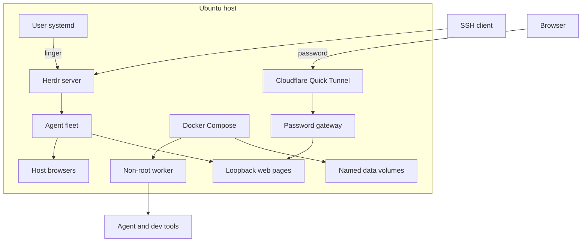
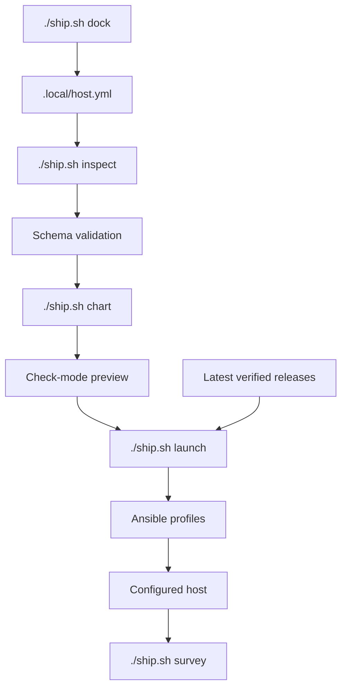
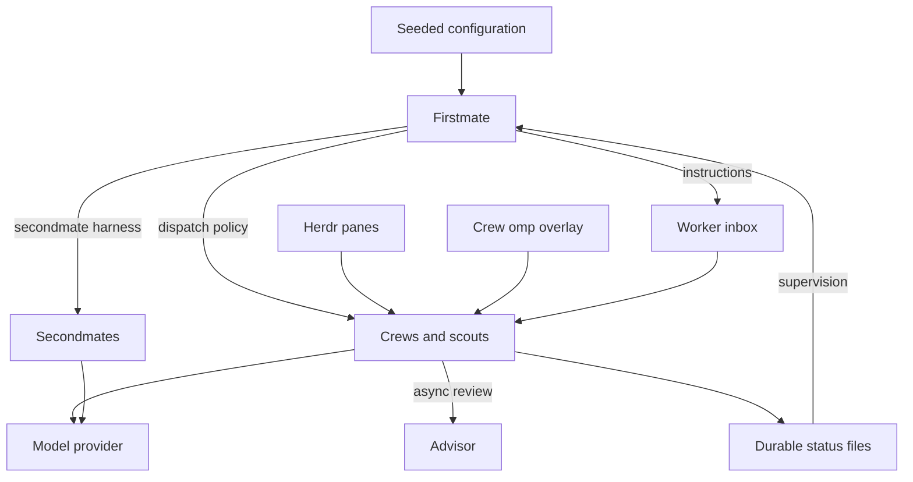
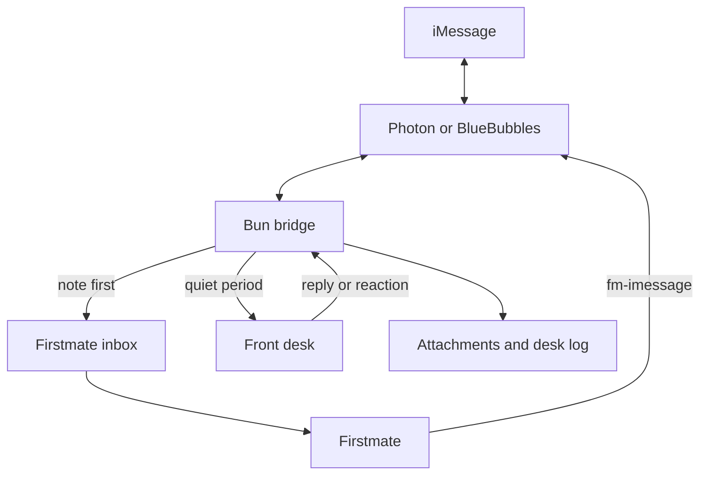
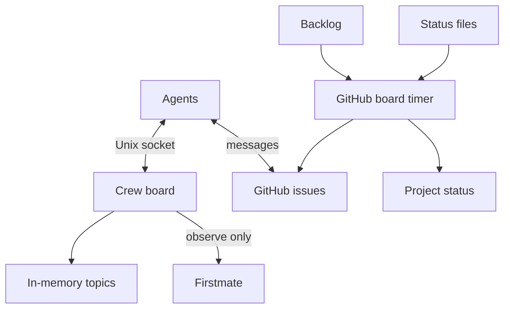
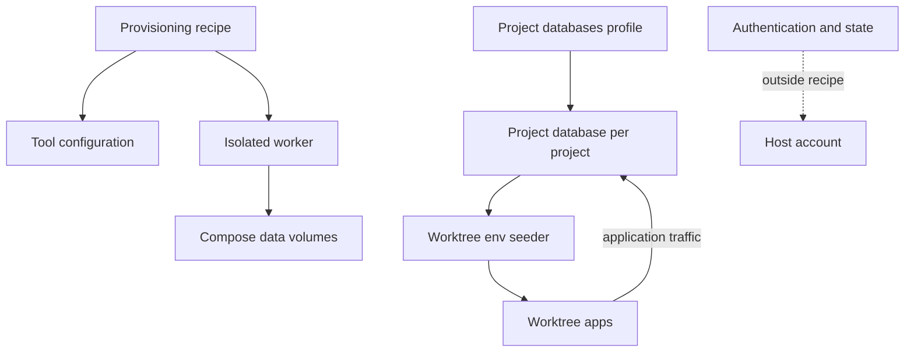

# Crewship architecture

## Host layout

Ansible manages the host; optional containers keep separate process and filesystem lifecycles. The [password gateway](gateway.md) is the default way to open the agents' web pages from a browser.

## Provisioning

Validate the host file, preview the changes, then apply selected profiles; omp plugins have no publisher checksums.

## Agent fleet and supervision

Firstmate supervises work through inboxes and status files; crews use the dispatch policy and call model providers directly.

### Stall nudge

A main Firstmate session can go idle after a context compaction and never start a turn, while wakes queue behind it. Hosts with the `firstmate` profile run `fm-main-stall-nudge.timer`, which starts `~/.local/bin/fm-main-stall-nudge` every 15 s (`journalctl --user -u fm-main-stall-nudge.service`). The script types a short nudge into main's Herdr pane when an operator note in `state/inbox` waits more than 45 s or a row in `state/.wake-queue` waits more than 600 s. It also nudges once for each answer a user left on a Lavish board (`~/.lavish-axi/state.json`) that nobody replied to within 300 s, for up to 24 h; `state/.stall-nudge-boards` records the answers it nudged, and a failed send leaves the answer unrecorded so the next try nudges it again. It nudges at most every 120 s.

It finds main as the pane in the Herdr session `default` that runs an agent in the Firstmate home. With no such pane, it logs a line and stops. A failed send is logged and the next try waits for the gap. Override the thresholds (`crewship_stall_nudge_note_max`, `crewship_stall_nudge_wake_max`, `crewship_stall_nudge_board_max`, `crewship_stall_nudge_gap`), the session, or pin a pane id (`crewship_stall_nudge_pane`) in `blueprint/ansible/group_vars/all/stall_nudge.yml`.

### Stuck-composer guard

`fm-send` skips its doorbell while a second mate's input box holds text, so a half-typed line can leave an inbox message unread. Hosts with the `firstmate` profile install `state/stuck-composer.check.sh` in the Firstmate home and bind it with `bin/fm-check-register.sh`, so the watcher runs it every cycle. For each second mate with an inbox message older than 120 s, the check reads the last composer line. If that text has not changed for 120 s, it saves the text to `state/.stuck-composer/<mate>.<epoch>.txt`, clears the line, rings the doorbell and prints one line for main. It reads panes at most every 30 s. A changed script is registered again on the next apply. Override the values (`crewship_stuck_composer_msg_age`, `crewship_stuck_composer_hold`, `crewship_stuck_composer_poll`) in `blueprint/ansible/group_vars/all/stuck_composer.yml`.

### GitHub reply alerts

Set `crewship_gh_replies_account` (the host's GitHub login) in `blueprint/ansible/group_vars/all/gh_replies.yml` to wake main when someone else replies on GitHub. An empty account installs nothing. The playbook installs `~/.local/bin/fm-gh-replies`, writes `state/gh-replies.check.sh` in the Firstmate home and registers it with `bin/fm-check-register.sh`, so the watcher polls it on its normal check cadence.

The script reads `GET /notifications` through `gh` (REST only; the host's `gh` login supplies the token) at most every `crewship_gh_replies_interval` seconds (60). For each new comment or review by another person it prints one line with repository, kind, author and URL, never the body. It ignores the account itself and bots. `state/.gh-replies/` holds the poll time, the `since` mark and the seen ids; the first run only seeds the mark.

### Instagram DM alerts

Set `crewship_instagram_dm_operator` (the operator's numeric Instagram user id) in `blueprint/ansible/group_vars/all/instagram_dm.yml` to wake main when the operator DMs the agent's Instagram account, and to let main answer. An empty id installs nothing. The playbook installs the [`instagram-dm`](../blueprint/skills/public/instagram-dm/SKILL.md) script as `~/.local/bin/instagram_dm.py`, the command `~/.local/bin/fm-insta-reply`, the service `instagram-dm-listen.service` and the backstop timer `instagram-dm-poll.timer`. The units wait until the session file exists: run `instagram_dm.py login` once (see the skill).

The service keeps Instagram's realtime channel (MQTT) open on the saved session. Each message event runs one poll, so a DM arrives in seconds. The event is a doorbell only: the poll reads the inbox and the message requests over HTTP, so the private event format is never parsed. A dead channel reconnects with backoff. Events are coalesced: any number of them cause one poll, at least 30 s after the last poll. The timer runs the same poll every `crewship_instagram_dm_interval` seconds (300) plus or minus 60 s in case an event is missed. Both take one lock, so a message is handled once.

A poll accepts a message request only from a thread that holds the operator alone and ignores every other sender. For each new message of the operator it runs `crewship_instagram_dm_notify` (`fm-inbox.sh note --request-id ig-ID -- "[Instagram DM from NAME; answer with fm-insta-reply] URL (by @AUTHOR, N s) caption: \"CAPTION\""`, which wakes main within about a second and makes a repeat harmless), appends one JSON line to `state/instagram-dms.jsonl`, and marks the message seen (the read receipt). It downloads no media and makes no request beyond the inbox reads: the author, caption and duration of a shared reel come from the DM payload and go into the note and the log row (`meta`), so Firstmate needs no fetch to know what it is. `state/.instagram-dms/poll.json` holds the last 5000 message ids, the failure count and the backoff. `fm-insta-reply [TEXT] [--thread ID] [--react EMOJI] [--typing]` answers the operator only, one short plain text at most.

Every write (text, tapback, typing indicator, read receipt) goes through one limiter, whose memory is `state/.instagram-dms/poll.json`: at least 20 s plus 0-10 s of random jitter after the previous write, at most 10 texts an hour and 40 a day, at most 20 tapbacks and typing indicators an hour together, and a typing indicator only before a text longer than 100 characters. A read receipt is skipped, not delayed, when it falls inside the gap. After any error, sends stop for 30 min (reads follow the shorter backoff below). A send over a limit exits with `not sending: ...`. Set the limits as `KEY=value` lines in `dm.env` next to the session file (`~/.config/crewship/instagram/dm.env`, read by the poll, the listener and `fm-insta-reply`): `INSTAGRAM_DM_WRITE_GAP`, `INSTAGRAM_DM_WRITE_JITTER`, `INSTAGRAM_DM_REPLIES_HOUR`, `INSTAGRAM_DM_REPLIES_DAY`, `INSTAGRAM_DM_SIGNALS_HOUR`, `INSTAGRAM_DM_ERROR_COOLDOWN`, `INSTAGRAM_DM_REALTIME_GAP`.

After a failed call the next calls wait 2, 4, 8 ... times the interval, up to 30 min, and every command refuses to call Instagram meanwhile. The first challenge, feedback block, suspension, `login_required`, please-wait, throttle or bad password halts them with no retry: main gets one note and nothing calls Instagram until a human has checked the account in the app and runs `instagram_dm.py resume`. Nothing logs in by itself: a missing or dead session is such a halt, and the one login is the manual `instagram_dm.py login` (`--force` for a second). Every failure names its exception class and endpoint.

A halt writes a flag file, `state/.instagram-dms/stop`, with its reason. `poll`, `listen`, `reply`, the reel curator, the front desk and `reel_watch.py` all check it and do nothing while it exists (the desk logs `skip (line stopped)`, drops the burst, and calls neither its model nor `fm-insta-reply`). `instagram_dm.py stop` is the kill switch: it writes the same flag by hand, with no Instagram call, and `instagram_dm.py resume` removes it. `reel_watch.py` finds the flag through `INSTAGRAM_DM_DIR` (default `~/.local/state/instagram-dm`): set that variable to the DM state directory in the environment of any agent that runs it.

A front desk, `instagram-desk.service`, answers a DM that main leaves alone for 8 s (60 s when the DM is a reel link; a run of links gets one `got N reels` and one tapback), the way the iMessage desk does: see [Instagram front desk](imessage.md#instagram-front-desk).

### Instagram reel curator

`instagram-reel-curator.timer` (09, 14 and 19 h, plus up to 90 min of jitter) runs `~/.local/bin/reel_curator.py run` as a user service. The playbook installs both with the DM units; the service waits until the session file and `crewship_instagram_curator_config` (`curator.json`: the seed `accounts` and `hashtags`, kept on the host, never in the repository) exist. A cycle uses the DM session and shares the DM lock only while it sends. It skips a reel found in `reels.jsonl` or in the operator's thread, transcribes with the `watch` skill, scores with one `omp -p` call, and shares at most 3 reels a day into the operator's thread with one line. Every pick, rejection, follow and halt is a line in `crewship_instagram_curator_log` with its score. A challenge, a 429 or `feedback_required` writes a `halt` row and stops the curator for 24 h. See the [skill](../blueprint/skills/public/instagram-dm/SKILL.md#reel-curator).

### Usage card

The stall nudge service has a second `ExecStart`, `~/.local/bin/fm-usage-remind`. While the owner texts (an iMessage note in `state/inbox` younger than 2 min), it runs `fm-usage-brief --png` and sends the card with `fm-imessage --image`, at most once per `crewship_usage_remind_every` seconds (default 3600). The card shows the 5 h and 7 d use of Claude and Codex, averaged across accounts, each with its soonest reset (from `omp usage --json`), plus server load, RAM and the mounts in `crewship_usage_disks` (default `/`). `fm-usage-brief` alone prints the same figures as text. `fm-text-card OUT.png < text` renders any short update as a card 840 px wide and at least 630 px high (about 4:3, so iMessage does not crop it; the constants `CARD_WIDTH` and `CARD_MIN_HEIGHT` in `fm-text-card`, which `fm-usage-brief` shares): the first line is the title, `# x` a section, `- x` a bullet, `k: v` a row. The scripts take their settings from `blueprint/ansible/group_vars/all/stall_nudge.yml`.

Cards are throwaway and nothing persists. `fm-usage-remind` renders to a temp file and deletes it as soon as the send returns.

The cards render with headless Chrome. The script uses `CHROME`, else `google-chrome`, `google-chrome-stable` or `chromium` on `PATH` (the `desktop` profile installs `google-chrome`; set `crewship_chrome_install: true` to install it without a desktop), else the Chrome that omp's puppeteer downloads under `~/.omp/puppeteer`. Set `CHROME` in the unit to use another binary. Both `ExecStart` lines carry the `-` prefix, so a failed nudge never blocks the card.

## iMessage

The optional bridge files each message before the front desk runs; Firstmate sends the full answer.

## Boards

The optional crew board keeps temporary host-local messages (see [how it is built](../apps/crewboard/README.md)); the GitHub board reads backlog and status without changing supervision.

## Data boundaries

Authentication and mutable state stay outside the recipe.
See [Project databases](shared-postgres.md) for the optional per-project worktree database.

[Agent architecture reference](agents/architecture.md)
