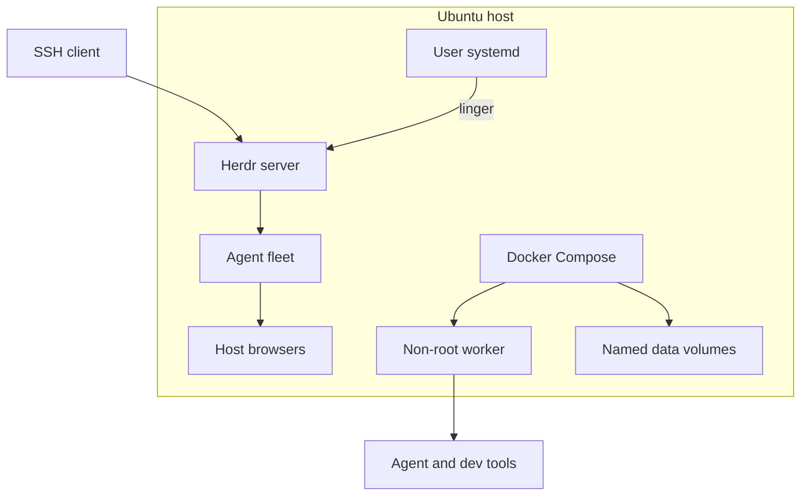
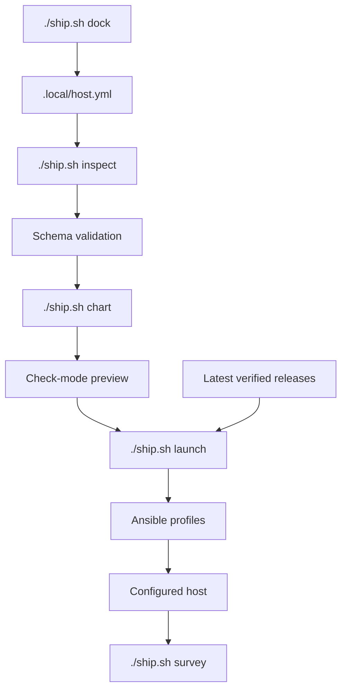
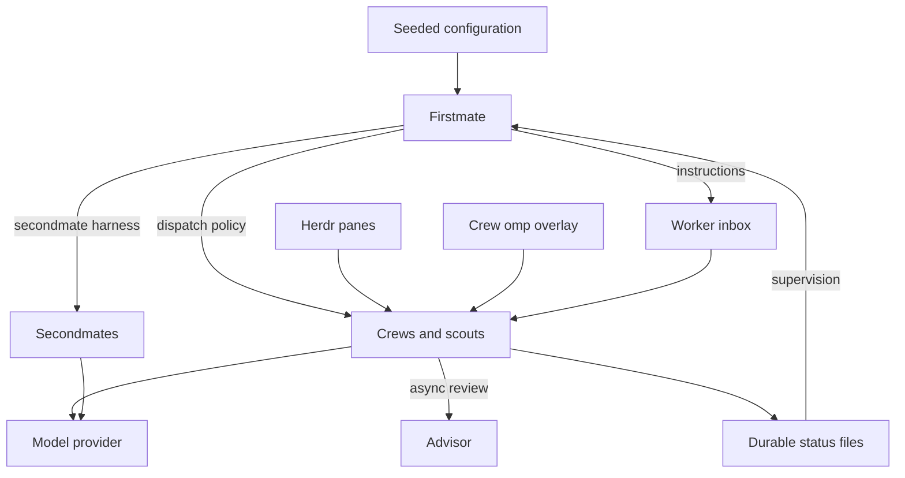
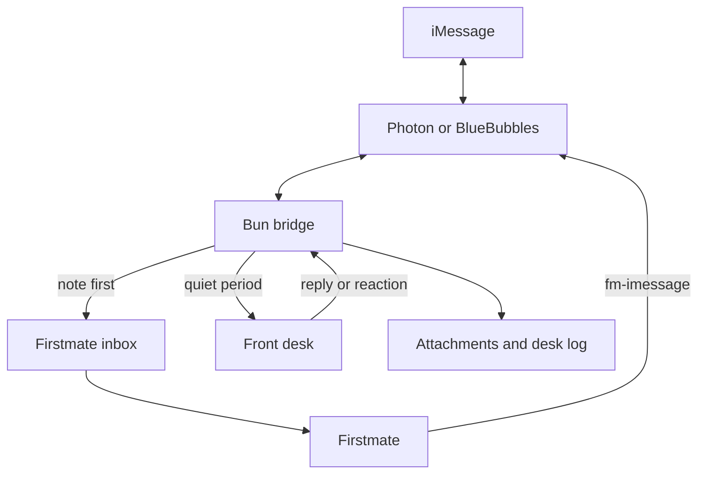
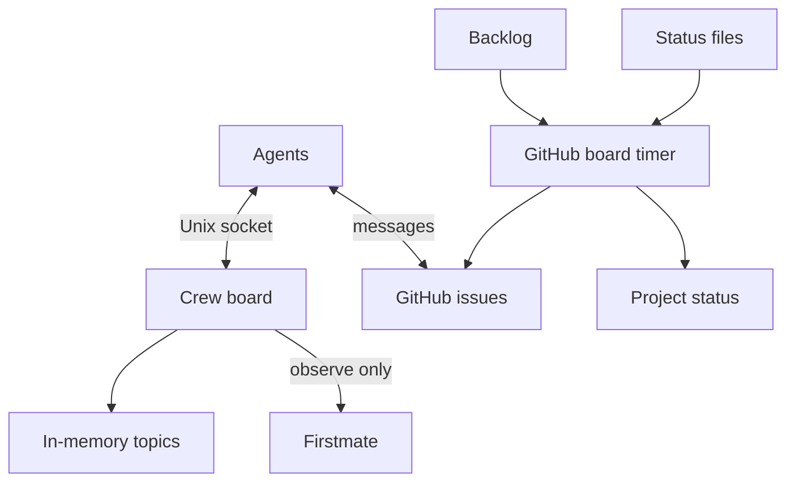
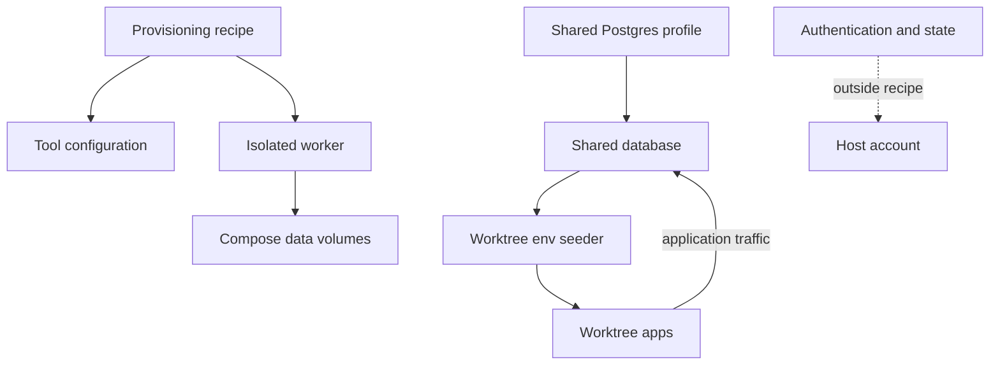

# Crewship architecture

## Host layout

Ansible manages the host; optional containers keep separate process and filesystem lifecycles.

## Provisioning

Validate the host file, preview the changes, then apply selected profiles; omp plugins have no publisher checksums.

## Agent fleet and supervision

Firstmate supervises work through inboxes and status files; crews use the dispatch policy and call model providers directly.

### Stall nudge

A main Firstmate session can go idle after a context compaction and never start a turn, while wakes queue behind it. Hosts with the `firstmate` profile run `fm-main-stall-nudge.timer`, which starts `~/.local/bin/fm-main-stall-nudge` every 15 s (`journalctl --user -u fm-main-stall-nudge.service`). The script types a short nudge into main's Herdr pane when an operator note in `state/inbox` waits more than 45 s or a row in `state/.wake-queue` waits more than 600 s. It also nudges once for each answer a user left on a Lavish board (`~/.lavish-axi/state.json`) that nobody replied to within 300 s, for up to 24 h; `state/.stall-nudge-boards` records the answers it nudged, and a failed send leaves the answer unrecorded so the next try nudges it again. It nudges at most every 120 s.

It finds main as the pane in the Herdr session `default` that runs an agent in the Firstmate home. With no such pane, it logs a line and stops. A failed send is logged and the next try waits for the gap. Override the thresholds (`crewship_stall_nudge_note_max`, `crewship_stall_nudge_wake_max`, `crewship_stall_nudge_board_max`, `crewship_stall_nudge_gap`), the session, or pin a pane id (`crewship_stall_nudge_pane`) in `ansible/group_vars/all/stall_nudge.yml`.

## iMessage

The optional bridge files each message before the front desk runs; Firstmate sends the full answer.

## Boards

The optional crew board keeps temporary host-local messages (see [how it is built](../crewboard/README.md)); the GitHub board reads backlog and status without changing supervision.

## Data boundaries

Authentication and mutable state stay outside the recipe.
See [Shared Postgres](shared-postgres.md) for the optional worktree database.

[Agent architecture reference](agents/architecture.md)
