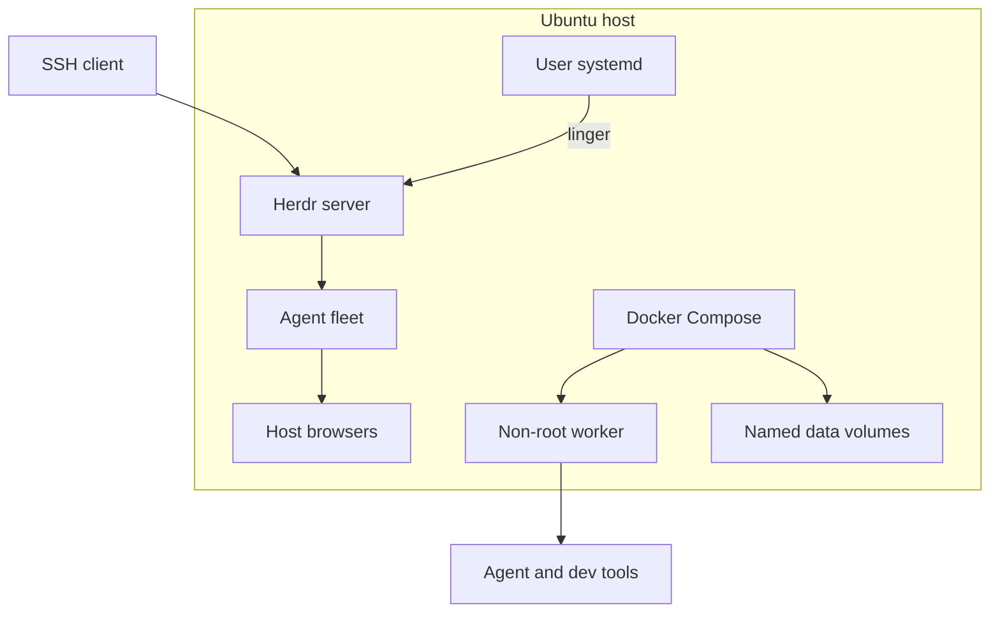
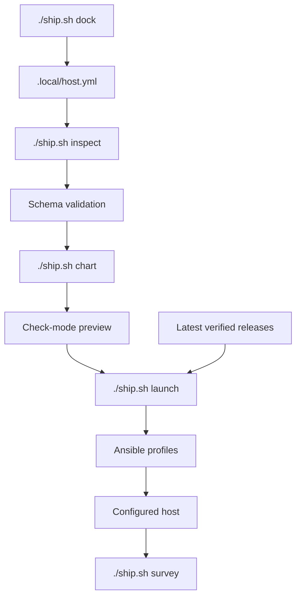
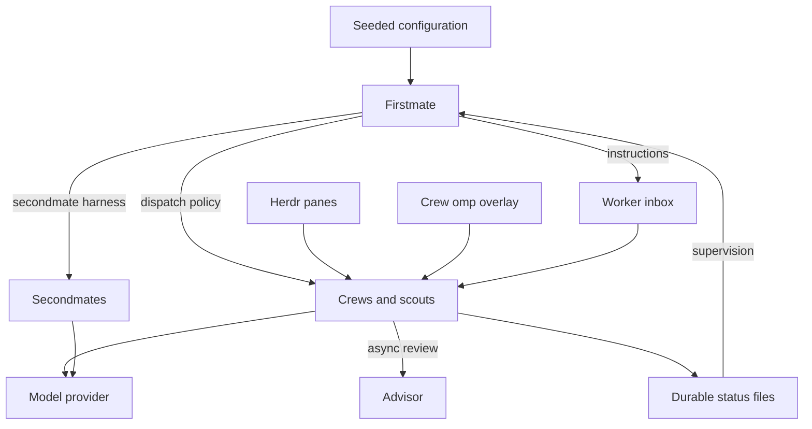
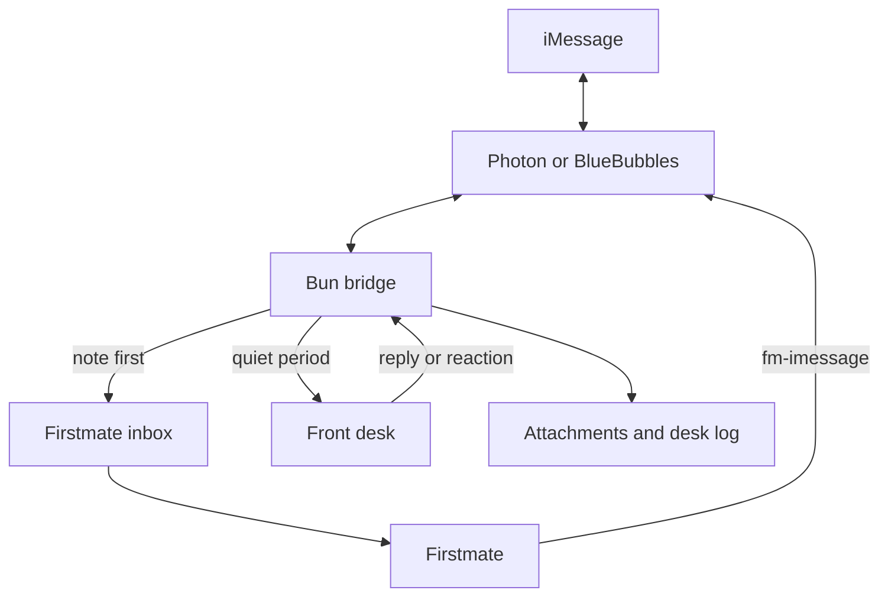
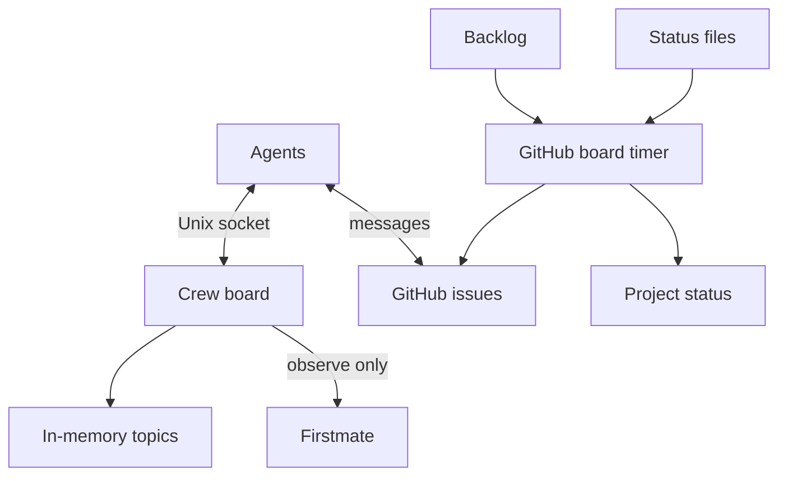
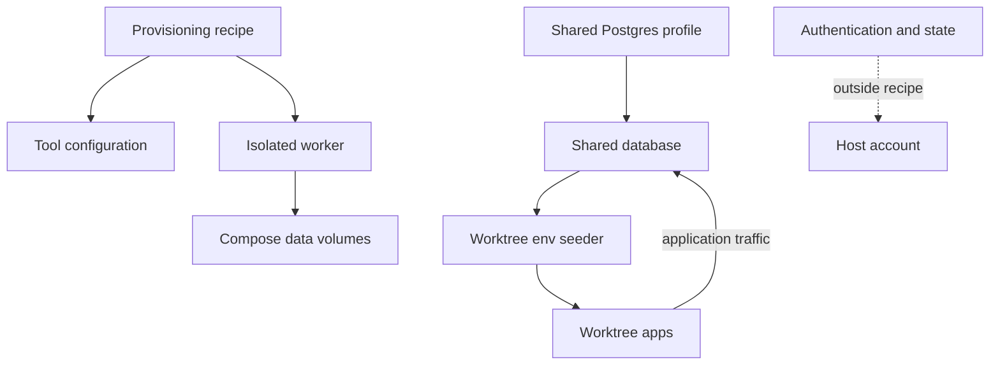

# Crewship architecture

## Host layout

Ansible manages the host; optional containers keep separate process and filesystem lifecycles.

## Provisioning

Validate the host file, preview the changes, then apply selected profiles; omp plugins have no publisher checksums.

## Agent fleet and supervision

Firstmate supervises work through inboxes and status files; crews use the dispatch policy and call model providers directly.

### Stall nudge

A main Firstmate session can go idle after a context compaction and never start a turn, while wakes queue behind it. Hosts with the `firstmate` profile run `fm-main-stall-nudge.timer`, which starts `~/.local/bin/fm-main-stall-nudge` every 15 s (`journalctl --user -u fm-main-stall-nudge.service`). The script types a short nudge into main's Herdr pane when an operator note in `state/inbox` waits more than 45 s or a row in `state/.wake-queue` waits more than 600 s. It also nudges once for each answer a user left on a Lavish board (`~/.lavish-axi/state.json`) that nobody replied to within 300 s, for up to 24 h; `state/.stall-nudge-boards` records the answers it nudged, and a failed send leaves the answer unrecorded so the next try nudges it again. It nudges at most every 120 s.

It finds main as the pane in the Herdr session `default` that runs an agent in the Firstmate home. With no such pane, it logs a line and stops. A failed send is logged and the next try waits for the gap. Override the thresholds (`crewship_stall_nudge_note_max`, `crewship_stall_nudge_wake_max`, `crewship_stall_nudge_board_max`, `crewship_stall_nudge_gap`), the session, or pin a pane id (`crewship_stall_nudge_pane`) in `blueprint/ansible/group_vars/all/stall_nudge.yml`.

### GitHub reply alerts

Set `crewship_gh_replies_account` (the host's GitHub login) in `blueprint/ansible/group_vars/all/gh_replies.yml` to wake main when someone else replies on GitHub. An empty account installs nothing. The playbook installs `~/.local/bin/fm-gh-replies`, writes `state/gh-replies.check.sh` in the Firstmate home and registers it with `bin/fm-check-register.sh`, so the watcher polls it on its normal check cadence.

The script reads `GET /notifications` through `gh` (REST only; the host's `gh` login supplies the token) at most every `crewship_gh_replies_interval` seconds (60). For each new comment or review by another person it prints one line with repository, kind, author and URL, never the body. It ignores the account itself and bots. `state/.gh-replies/` holds the poll time, the `since` mark and the seen ids; the first run only seeds the mark.

### Usage card

The stall nudge service has a second `ExecStart`, `~/.local/bin/fm-usage-remind`. While the owner texts (an iMessage note in `state/inbox` younger than 2 min), it runs `fm-usage-brief --png` and sends the card with `fm-imessage --image`, at most once per `crewship_usage_remind_every` seconds (default 3600). The card shows the 5 h and 7 d use of Claude and Codex, averaged across accounts, each with its soonest reset (from `omp usage --json`), plus server load, RAM and the mounts in `crewship_usage_disks` (default `/`). `fm-usage-brief` alone prints the same figures as text. `fm-text-card OUT.png < text` renders any short update as a card 840 px wide and at least 630 px high (about 4:3, so iMessage does not crop it; the constants `CARD_WIDTH` and `CARD_MIN_HEIGHT` in `fm-text-card`, which `fm-usage-brief` shares): the first line is the title, `# x` a section, `- x` a bullet, `k: v` a row. The scripts take their settings from `blueprint/ansible/group_vars/all/stall_nudge.yml`.

The cards render with headless Chrome. The script uses `CHROME`, else `google-chrome`, `google-chrome-stable` or `chromium` on `PATH` (the `desktop` profile installs `google-chrome`; set `crewship_chrome_install: true` to install it without a desktop), else the Chrome that omp's puppeteer downloads under `~/.omp/puppeteer`. Set `CHROME` in the unit to use another binary. Both `ExecStart` lines carry the `-` prefix, so a failed nudge never blocks the card.

## iMessage

The optional bridge files each message before the front desk runs; Firstmate sends the full answer.

## Boards

The optional crew board keeps temporary host-local messages (see [how it is built](../apps/crewboard/README.md)); the GitHub board reads backlog and status without changing supervision.

## Data boundaries

Authentication and mutable state stay outside the recipe.
See [Shared Postgres](shared-postgres.md) for the optional worktree database.

[Agent architecture reference](agents/architecture.md)
