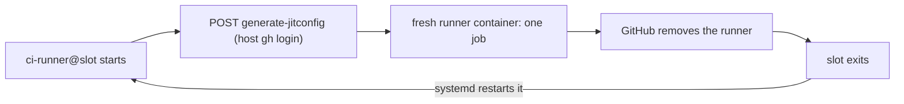

# CI pool

The CI pool runs GitHub Actions jobs on this host with no runner to register or remove by hand. One list in `.local/host.yml` names each repository and its number of slots. Each slot is a systemd user unit that asks GitHub for a just-in-time (JIT) runner, runs one job in a fresh container, and exits. GitHub removes a JIT runner after its one job, and systemd starts the slot again for the next job.



## Opt a repository in

1. Add the repository to `crewship.ci_pool.repos` in `.local/host.yml`:

   ```yaml
   crewship:
     ci_pool:
       data_dir: /mnt/data/ci     # on a data disk, not the system disk
       # total_slots: auto        # or a number; see "Pool size"
       # job_cpus: 4              # CPU cap of each job container
       # job_memory_gb: 8         # memory cap of each job container
       # image: crewship-ci-runner:latest   # see "What a job gets"
       repos:
         - repo: owner/name
           slots: 2
           labels: [my-label]
           # docker: dind           # a Docker daemon of its own in each slot; see "Docker in a job"
           # userns: true           # with docker: dind, on a host that restricts user namespaces
   ```

2. Run `./ship.sh launch`. To change only the pool, without a full apply, use [Apply without the playbook](#apply-without-the-playbook).
3. In the repository's workflow, run the job on the pool:

   ```yaml
   runs-on: [self-hosted, my-label]
   ```

Every slot carries the `self-hosted` label and the labels of its repository entry. The account that runs the pool must have a `gh` login that can administer the repository's runners (the `repo` scope).

To remove a repository, delete its entry and apply again. Its idle slots stop and are disabled, and its work and cache directories are deleted. A slot that runs a job at that time is disabled but not stopped: it finishes the job, then leaves, and a later apply deletes its directories. To stop the whole pool, set `repos: []` and apply. Removing the whole `ci_pool` section does not stop running slots, because apply then skips the pool.

## Configuration

| Key | Default | Meaning |
| --- | --- | --- |
| `data_dir` | required | Parent of the pool's directory `<data_dir>/ci-pool/`, which holds every work directory and cache. Apply creates `data_dir`, owned by `crewship.user`. Put it on a data disk. The pool deletes only inside `<data_dir>/ci-pool/`, so `data_dir` may hold other data. |
| `total_slots` | `auto` | Most slots the pool runs. `auto` computes it at apply (see below). A number fixes it. |
| `job_cpus` | `4` | `docker --cpus` of each job container. |
| `job_memory_gb` | `8` | `docker --memory` and `--memory-swap` of each job container, in GiB. |
| `image` | `crewship-ci-runner:latest` | Image of each job container. The default is built on the host (see [What a job gets](#what-a-job-gets)). Any other name is pulled hourly and used as it is. |
| `repos[].repo` | required | `owner/name` on github.com. |
| `repos[].slots` | required | Slots for this repository: the most jobs it runs at one time. |
| `repos[].labels` | required | Runner labels that the workflow's `runs-on` selects. |
| `repos[].docker` | none | `dind` gives each slot of the repository its own Docker daemon. See [Docker in a job](#docker-in-a-job). |
| `repos[].userns` | `false` | With `docker: dind`: run the repository's sidecars under the AppArmor profile `ci-dind-userns`, which allows the user namespace that rootless Docker needs on a host with `kernel.apparmor_restrict_unprivileged_userns=1`. See [Docker in a job](#docker-in-a-job). |

`./ship.sh inspect` refuses the pool without the `docker` profile, a `data_dir` with `..`, `userns` without `docker`, and two repositories that make the same unit name.

## Pool size

With `total_slots: auto`, apply takes half of the host's CPUs and memory. It reads the totals, not the load, so the size is the same on every apply and does not change while jobs run:

```
total_slots = floor(min(CPUs × 0.5 / job_cpus,
                        MemTotal GiB × 0.5 / job_memory_gb))
```

The other half stays free for the agents and for load peaks. Example: 96 CPUs and 247 GiB with the default caps give `min(12, 15.4)`, so 12 slots.

Slots are assigned in list order. When the repository entries ask for more slots than the total, apply starts the first ones, prints a warning that names the slots it did not start, and starts nothing else.

When the total drops, apply stops the idle slots that are over it. A slot that runs a job is never stopped: apply disables it, and it leaves after its current job. A job is never killed by apply.

When apply changes `pool.json`, it restarts the idle slots, so they register again with the new labels and caps. A slot that runs a job keeps its settings until the job ends; its next start reads the new file.

## What a job gets

- The pool's own image `crewship-ci-runner:latest`: the official runner image `ghcr.io/actions/actions-runner:latest` (Ubuntu, the `runner` user with passwordless `sudo`) plus `build-essential`, `pkg-config`, the GTK 3 runtime, Postgres 17 and 18 with their clients, pgvector for 18, `unzip`, `git`, `curl`, `bun`, and the `docker compose` plugin. A job that runs `apt-get install` for these finds them installed. `ci-pool-image.timer` rebuilds the image every hour from the latest official image (apt and bun update once a day), so a job never pulls or installs them. Until the first build ends, jobs start from the official image. The list is `DOCKERFILE` in `ci-pool.py`.
- The CPU and memory caps above, and at most 8192 processes.
- No Docker daemon by default: the host's Docker socket is never mounted. A repository with `docker: dind` gets a daemon of its own (see [Docker in a job](#docker-in-a-job)). Other jobs that build or run containers stay on GitHub-hosted runners.
- An empty `_work` directory for each job, emptied when the container starts.
- Caches that stay between the jobs of one repository: the tool cache (`RUNNER_TOOL_CACHE`, which the `actions/setup-*` actions use), `~/.cache` (uv, pip, and other tools), the bun, npm, and pnpm stores (`BUN_INSTALL_CACHE_DIR`, `npm_config_cache`, `npm_config_store_dir`, set below `~/.cache`), and the cargo registry and git directories (`~/.cargo/registry`, `~/.cargo/git`). The downloaded apt packages and lists (`/var/cache/apt/archives`, `/var/lib/apt/lists`) stay for each slot, not for the repository, because apt locks that directory.
- Data-disk directories for the heavy writes: Docker keeps the files that a container writes on the system disk, so each slot mounts its own directories from `<data_dir>` over `/tmp`, `/var/lib/postgresql`, and `~/.bun`, besides the apt and cache paths above. The slot deletes these three with `sudo -n rm` when a job starts (the job's files belong to other user IDs), so a job starts with an empty `/tmp` and `~/.bun` and, in the pool's own image, fresh Postgres 17 and 18 clusters. A custom `image` finds `/var/lib/postgresql` empty (it has no cluster to start from).
- A check before the first step: the runner's job-started hook ends the job container when its code comes from outside the repository, which is a pull request from a fork or a `workflow_run` that a fork's pull request started. The hook kills every process in the container, so no later step runs, not even an `if: always()` step. The slot then deletes the runner. Only the repositories in the pool's list, and only their own branches, run on the host.

### Postgres in the pool's image

The image has a `main` cluster for Postgres 17 and for Postgres 18. Both clusters use port 5432 and do not start at boot, so a job starts only the version it needs, with one command:

| Version | Start command |
| --- | --- |
| 17 | `sudo pg_ctlcluster 17 main start` |
| 18 | `sudo pg_ctlcluster 18 main start` |

Stop the other version first (`sudo pg_ctlcluster 17 main stop`), or the start fails on port 5432. Postgres 18 has pgvector: `CREATE EXTENSION vector;` works after the start.

## Docker in a job

A repository entry with `docker: dind` gives each of its slots a Docker daemon of its own, for example for `docker compose up` in an end-to-end test. The job never gets the host's Docker socket.

- For each job, the slot starts a sidecar container `ci-dind-<slot>` from `docker:dind-rootless` on a network `ci-dind-<slot>` of its own. The job container joins the sidecar's network namespace, so no other container reaches the daemon or the ports that it publishes.
- The job gets `DOCKER_HOST=tcp://localhost:2376`, `DOCKER_TLS_VERIFY=1`, and `DOCKER_CERT_PATH=/certs/client` (the client certificate only, read-only). A port that a compose service publishes is on the job's `localhost`, as on a GitHub-hosted runner. The pool's image has the `docker` CLI and the compose plugin; a custom `image` must bring its own.
- The daemon keeps its images and containers in `<data_dir>/ci-pool/dind/<slot>/`, which the slot deletes and makes again for each job. Each job starts with no images.
- The sidecar has the same CPU, memory, and process caps as the job container. The containers inside it count against the sidecar's caps. A `docker: dind` slot can thus use two times `job_cpus` and `job_memory_gb`, which the [pool size](#pool-size) does not count: lower `total_slots` when many slots use it.
- The slot waits until the daemon answers before it starts the job, and removes the sidecar and its network after the job container, with the same stop grace period and wait for the removal.

The sidecar runs with `--privileged`, also in its rootless form. Code that gets root in the sidecar has root on the host. The job's code reaches only the daemon, which runs as a non-root user in a user namespace, so a container that a job starts is not root on the host. The job container itself is never privileged. Use `docker: dind` only for a private repository whose pull requests come from its own branches. The job-started hook already refuses code from forks.

On a host with `kernel.apparmor_restrict_unprivileged_userns=1` (Ubuntu's default), the kernel moves the sidecar's `rootlesskit`, which is not root, into the `unprivileged_userns` profile when it creates its user namespace, and that profile denies the capabilities it needs: the sidecar exits a few seconds after it starts, and the slot fails after the daemon timeout. Leave the sysctl alone and set `userns: true` on the repository entry instead. Apply then loads the profile `ci-dind-userns` with `sudo -n apparmor_parser` and writes it to `/etc/apparmor.d/ci-dind-userns`, before it changes any unit or `pool.json`: a profile that confines nothing and allows only the user namespace. When `sudo` refuses or the parser rejects the profile, apply exits with an error and leaves the pool as it was; the account needs a passwordless `sudo` rule for `apparmor_parser` and `install`. Only the sidecars of that repository run under it (`--security-opt apparmor=ci-dind-userns`); every other sidecar, every job container, and the host's setting stay as they are. `apparmor.service` loads the file again at boot.

## Files on the host

| Path | Contents |
| --- | --- |
| `~/.local/bin/ci-pool.py` | The script: `apply` converges the slots, `run <slot>` is each slot's `ExecStart`, `watch` is the timer's command. |
| `~/.config/systemd/user/ci-runner@.service` | The one unit template. Apply writes it; instances are `ci-runner@<owner>-<name>-<n>.service`. |
| `~/.config/systemd/user/ci-pool-watch.{service,timer}` | The watch timer (see [Stalled slots](#stalled-slots)). Apply writes and enables it. |
| `~/.config/systemd/user/ci-pool-image.{service,timer}` | The hourly image build. Apply writes and enables it. |
| `~/.config/ci-pool/pool.json` | The `ci_pool` section as apply last wrote it. Each slot reads it when it starts. |
| `~/.config/ci-pool/job-started.sh` | The job-started hook. Apply writes it; each job container mounts it read-only. A slot whose hook file is missing does not start a job. |
| `<data_dir>/ci-pool/work/<slot>/` | The slot's job work directory. |
| `<data_dir>/ci-pool/cache/<owner>-<name>/tool/`, `home/`, `cargo-registry/`, `cargo-git/` | The repository's tool cache, `~/.cache`, and cargo directories. |
| `<data_dir>/ci-pool/scratch/<slot>/` | The slot's `/tmp`, Postgres cluster directory, and `~/.bun`, deleted at each job start. |
| `<data_dir>/ci-pool/apt/<slot>/` | The slot's downloaded apt packages and lists. |
| `<data_dir>/ci-pool/dind/<slot>/` | With `docker: dind`: the slot's Docker daemon data and TLS certificates, deleted at each job start. |
| `/etc/apparmor.d/ci-dind-userns` | With `userns: true`: the sidecar's AppArmor profile. Apply loads it with `sudo -n apparmor_parser`, then installs the file. |

No token is stored. Each slot reads the host's `gh` login when it starts. When an account is not in the `docker` group, the script runs `sudo -n docker`.

## See what runs

```bash
systemctl --user list-units 'ci-runner@*'          # the slots and their state
journalctl --user -u 'ci-runner@*' -f              # runner names, job progress, errors
sudo docker ps --filter label=crewship.ci-pool # one container for each slot, two with docker: dind
gh api repos/OWNER/NAME/actions/runners            # the runners GitHub knows
```

A slot that waits for a job shows as an `online` runner that is not busy. In a job log, the "Set up job" step names the runner: `pool-<slot>-<unix time>`.

## Stalled slots

On a loaded host the Docker daemon can stall a call for good. A slot then holds a registered runner that shows `offline` and has no container, so jobs wait in the queue. Two guards stop this:

- Every `docker create`, `docker pull`, and other short Docker call that the script starts ends after 600 seconds (a create takes minutes when the host load is high). The slot removes the half-created container and the runner, waits 60 seconds, and exits with an error, and systemd restarts it. Set `CI_POOL_DOCKER_TIMEOUT` (seconds) in the unit (`systemctl --user edit ci-runner@.service` and `ci-pool-image.service`) to change the limit.
- `ci-pool-watch.timer` runs `ci-pool.py watch` every minute. It restarts a slot only when all of this holds:
  - the slot started more than 5 minutes ago,
  - GitHub shows its runner `offline` and not busy, and
  - the Docker daemon listed no container for the slot (`docker ps --all`, any state) in two successful reads at least 2 minutes apart. The first sighting is kept in `~/.config/ci-pool/watch-state.json`, written whole through a temporary file, so an interrupted or failed write keeps the old file. An empty file (what an interrupted or failed write of the old writer left behind) counts as no sightings; `watch` logs it and starts them again.

  A read that fails or takes more than 60 seconds acts on nothing and forgets the first sightings, because a loaded daemon answers slowly or in part. `watch` restarts at most 2 slots a run and prints `restart <unit>: <reason>` to the journal (`journalctl --user -u ci-pool-watch`). It also removes a container that is stuck in `removing` or `dead` when its slot unit is stopped. `ci-pool.py watch --dry-run` prints what it would do and changes nothing.
- A slot that starts or stops waits for its old container: it stops it with a 60-second grace period, removes it, and waits until the daemon no longer lists it before it creates the next one. A slot whose old container still runs a job (a `Runner.Worker` process) does not touch it: the slot fails, waits 60 seconds, and systemd starts it again. The unit uses `KillMode=mixed`, so `systemctl stop` signals only `run`, which does this cleanup within `TimeoutStopSec=300`.

Jobs create the container with `--pull missing`. `ci-pool-image.timer` refreshes the image once an hour instead, so the slots do not pull at the same time.

## Apply without the playbook

The playbook is not necessary for the pool. On a host where you do not want a full apply, run the same steps by hand:

```bash
sudo install -d -o "$USER" -g "$USER" -m 0755 /mnt/data/ci
install -m 0755 blueprint/maintenance/ci-pool.py ~/.local/bin/ci-pool.py
echo '{"data_dir": "/mnt/data/ci", "repos": [{"repo": "owner/name", "slots": 2, "labels": ["my-label"]}]}' \
  | python3 blueprint/maintenance/ci-pool.py apply --check   # preview; then run it without --check
```

`apply` prints one line for each change and nothing when the pool already matches the config.

## Public repositories

A self-hosted runner runs the code of the workflow that selects it. On a public repository, a pull request from a fork can change the workflow. The job-started hook ends such a job's container before any of its steps run. That is the first barrier; the trigger rule below is the second. The job container limits CPU, memory, and processes, and has no Docker socket, but it shares the host's network, and its caches stay for the next job of the same repository.

- Opt in private repositories freely. For a public repository, select the pool only in workflows that outside contributors cannot start: `workflow_dispatch` and `push` to protected branches. Never use `pull_request` from forks.
- This repository's `ci.yml` stays on GitHub-hosted runners. `ci-pool-smoke.yml` runs the same checks on the pool, and only `workflow_dispatch` starts it. It stays queued until `.local/host.yml` has the entry `{ repo: i098/Crewship, slots: N, labels: [crewship] }` in `crewship.ci_pool.repos`.
- Do not opt in a repository whose jobs need secrets that a fork pull request could reach.
- A job can change the repository's caches (`<data_dir>/ci-pool/cache/<owner>-<name>/`), which later jobs of that repository read, including jobs on the default branch. Each JIT runner is registered to one repository only, so other repositories' jobs never run in its slots or read its caches.

## macOS runner

The pool runs Linux jobs only. For macOS jobs, `blueprint/maintenance/mac-runner.sh` runs just-in-time runners on a Mac that you reach with `ssh mac` (see [SSH to a Mac](security.md#ssh-to-a-mac)).
Each repository gets one launchd user agent. The agent asks GitHub for a JIT runner, runs one job, and exits; launchd then starts it again.
The agent reads the Mac's own `gh` login, so the Mac needs `gh` signed in with the `repo` scope. No token is stored.
Every file is in one folder, `~/actions-runner-<name>/`, except one plist for each repository in `~/Library/LaunchAgents/`.

Install, from this repository on the host (the folder name is free; this example uses `i098`):

```bash
ssh mac 'mkdir -p ~/actions-runner-i098 && cat > ~/actions-runner-i098/mac-runner.sh && chmod +x ~/actions-runner-i098/mac-runner.sh' \
  < blueprint/maintenance/mac-runner.sh
ssh mac '~/actions-runner-i098/mac-runner.sh install owner/name another/repo'
```

`install` downloads the latest official `osx-arm64` runner and checks its SHA-256 digest from the GitHub release. Run it again to update the runner or to add a repository. It restarts the agents that it names, and a job that runs on one of them stops.

In the workflow, run the job on the runner, and start the workflow only for files that can change the macOS result:

```yaml
on:
  pull_request:
    paths: [.github/workflows/mac.yml, "**/*.swift", "**/*.plist", "**/*[mM]ac[oO][sS]*"]
jobs:
  test:
    runs-on: [self-hosted, macOS, mac-name]   # mac-<repository name>
```

What a job gets:

- The account's own user, with a `HOME` in `~/actions-runner-<name>/home/`. Toolchains and caches that jobs install (rustup, npm, the tool cache) stay there. Repositories share that `HOME`.
- `PATH=/usr/bin:/bin:/usr/sbin:/sbin`, and Xcode when it is installed. No `gh` login.
- An empty work directory (`<owner>-<name>/_work/`) and `TMPDIR` for each job, and the launchd `Nice` value 10, so the Mac stays responsive.
- The same check as the pool before the first step: the job-started hook ends the runner when the code comes from a fork's pull request or a `workflow_run` that one started.

A job runs as the account on the Mac, without a container. It can read what that account can read. Opt in only repositories whose code you trust, and see [Public repositories](#public-repositories).

See what runs:

```bash
ssh mac 'launchctl list | grep mac-runner'                          # one agent for each repository
ssh mac 'tail ~/actions-runner-i098/<owner>-<name>/agent.log'        # runner IDs and job results
gh api repos/OWNER/NAME/actions/runners                             # mac-<name>-<unix time> runners
```

Remove everything (the agents, their plists, and the folder):

```bash
ssh mac '~/actions-runner-i098/mac-runner.sh remove'
```

A runner that waited for a job then shows as offline in the repository settings. GitHub deletes an offline JIT runner within one day. To delete it at once, run `gh api -X DELETE repos/OWNER/NAME/actions/runners/ID`.
