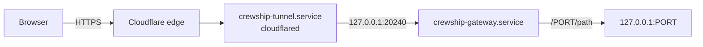

# Web pages from anywhere: the password gateway

Agents on the host serve web pages: Lavish boards, dev previews, and other local services.
These pages listen on loopback, so you cannot open them from a phone or a laptop without help.

The password gateway is the default way in.
It puts one password in front of every local web page and serves the pages over a [Cloudflare Quick Tunnel](https://developers.cloudflare.com/cloudflare-one/networks/connectors/cloudflare-tunnel/do-more-with-tunnels/trycloudflare/).
The tunnel gives an `https://….trycloudflare.com` address and needs no Cloudflare account, no open port, and no DNS change.
[Tailscale](#tailscale-instead) stays available as an option.

## Open a page

1. Find the address. The installer and every `./ship.sh launch` print it at the end. On the host, this command prints it again:

   ```bash
   crewship-gateway url
   ```

2. Open the address in any browser and enter the password.
3. Open a local page as `/PORT/path`. For example, a Lavish board on port 9525 is `https://….trycloudflare.com/9525/`. The start page lists the ports that listen on the host.

After the right password, your IP address is allowed for 24 hours.
The browser also gets a cookie that lasts as long.
The cookie keeps a phone signed in when its mobile network changes its address.

## The password

The first apply makes a random password, for example `k3m9x-4tqhe-p7rwn-a2bcd`.
The launch summary shows it one time. Keep it in your password manager.
The host keeps only an scrypt hash of it, as `CREWSHIP_GATEWAY_PASSWORD_HASH` in `~/super.env` (mode `600`).

To set a new password, run this on the host. It prints the new password one time and signs out every address and every browser:

```bash
crewship-gateway password
```

[`scripts/fetch-secrets.sh`](secrets.md) replaces `~/super.env`, which removes the hash.
Then the gateway refuses every password until you run `crewship-gateway password` or the next `./ship.sh launch` sets a new one.

## Settings

Set the allow window in hours in `.local/host.yml`, then run `./ship.sh launch`:

```yaml
crewship:
  gateway:
    allow_hours: 24    # the default; 1 to 8760
```

## Sign out and revoke

- **Sign out** on the start page removes your address and your cookie.
- `crewship-gateway revoke 203.0.113.5` removes one address.
- `crewship-gateway revoke` removes every address and makes every cookie invalid.

Five wrong passwords from one address within 15 minutes lock that address out for 15 minutes.
Other addresses can still sign in.

## Turn it off

- On a new host, give the installer `--no-gateway`, for example `npx crewship --no-gateway`.
- On a host that has a config, set `profiles.gateway: false` in `.local/host.yml` and run `./ship.sh launch`. The apply stops and removes both services.

## How it works



- `crewship-gateway.service` runs `~/.local/bin/crewship-gateway serve` on `127.0.0.1:20240`. It refuses a peer that is not on loopback. It opens no port to the network.
- `crewship-tunnel.service` runs `cloudflared tunnel --url http://127.0.0.1:20240`, so the gateway is its only origin. It sends nothing to a local page directly. When the gateway is down, the tunnel answers 502 and shows no page.
- Cloudflare's edge sets `CF-Connecting-IP` on every request and replaces a value that the visitor sends. Only loopback peers reach the gateway, so a request from off the host comes through the tunnel, and the gateway trusts that header. It never reads `X-Forwarded-For`. A request without a valid `CF-Connecting-IP` gets 400. A local process can send any header, but it already reaches every loopback port directly, so the header gives it nothing more.
- The password check uses scrypt and a constant-time compare.
- The cookie `__Host-crewship` is `HttpOnly`, `Secure`, and `SameSite=Strict`. It is an HMAC of its issue time, with a key from the stored hash, so a new password makes every cookie invalid. The gateway removes the cookie before it sends a request to a local page.
- The allowed addresses are in `~/.local/state/crewship/gateway.json`, so a restart keeps them. The lockout counts are in memory only.
- After sign-in, every loopback port from 1024 up is reachable. That is the same access that your account has on the host.

The tunnel gets a new address each time it starts, for example after a reboot.
Apply restarts the tunnel only when its unit file changes.
Run `crewship-gateway url` to see the current address.

## Quick Tunnel limits

Cloudflare offers Quick Tunnels for testing and development, without an uptime guarantee.
A Quick Tunnel proxies at most 200 requests at the same time, and it does not support Server-Sent Events (SSE).
WebSocket connections work.
For a fixed address or SSE, use a named Cloudflare Tunnel on your own account, or Tailscale.

## Tailscale instead

Tailscale gives a private network with a fixed name for the host.
It needs a Tailscale account and a sign-in on each device.

1. Set `profiles.tailscale: true` in `.local/host.yml` and run `./ship.sh launch`. The apply installs the daemon only.
2. Join the tailnet: `sudo tailscale up`.
3. Open a local page from a device on the tailnet, for example with `tailscale serve`.

[Security](security.md#remote-access) has the Tailscale details.
You can use both: the gateway and Tailscale do not affect each other.

## Tests

- `uv run pytest tests/test_gateway.py` checks the password, the allow window, the lockout, the cookie, and the header trust.
- `bash tests/gateway-smoke.sh` runs the gateway and a real Quick Tunnel in a clean `ubuntu:24.04` container. It signs in through the public address, then moves the clock 25 hours ahead and checks that the address and the cookie are refused. It needs Docker and outbound HTTPS.
