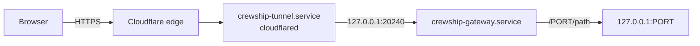

# Web pages from anywhere: the password gateway

Agents on the host serve web pages: Lavish boards, dev previews, and other local services.
These pages listen on loopback, so you cannot open them from a phone or a laptop without help.

The password gateway is the default way in on a new host.
It puts one password in front of every local web page and serves the pages over a [Cloudflare Quick Tunnel](https://developers.cloudflare.com/cloudflare-one/networks/connectors/cloudflare-tunnel/do-more-with-tunnels/trycloudflare/).
The tunnel gives an `https://….trycloudflare.com` address and needs no Cloudflare account, no open port, and no DNS change.
[Tailscale](#tailscale-instead) stays available as an option.

## Open a page

1. Find the address. The installer and every `./ship.sh launch` print it at the end. On the host, this command prints it again:

   ```bash
   crewship-gateway url
   ```

2. Open the address in any browser and enter the password.
3. Open a local page as `/PORT/path`. For example, a Lavish board on port 9525 is `https://….trycloudflare.com/9525/`.
   A dev server such as Vite or Next.js loads its files from root paths, for example `/@vite/client` or `/_next/static/…`.
   The gateway sends such a path to the port of the page that asked for it. It takes the port from the `Referer` header, or else from the `__Host-crewship-port` cookie (1 hour).
   Only a page that you open in a tab sets this cookie; the files and requests of a page never change it.
   The path `/` stays the start page unless the `Referer` names a port.
   With two different dev apps of this kind open in two tabs at once, reload the tab you switch to.

After the right password, your IP address is allowed for 24 hours.
The browser also gets a cookie that lasts as long.
The cookie keeps a phone signed in when its mobile network changes its address.

## The password

The first apply makes a random password, for example `k3m9x-4tqhe-p7rwn-a2bcd`.
It writes the password only to `~/.config/crewship/gateway/initial-password` (mode `600`).
The launch summary and the installer name that file. They never show the password.
Read the file yourself over SSH, keep the password in your password manager, then delete the file:

```bash
cat ~/.config/crewship/gateway/initial-password
```

Never let an agent read, print, or relay the password.
The host keeps only an scrypt hash of it, in `~/.config/crewship/gateway/password.hash` (directory `700`, file `600`).
The hash stays on this host: each host has its own password, and [`scripts/fetch-secrets.sh`](secrets.md) does not touch it.

To set a new password, run this in your own terminal on the host. It prints the new password one time, removes `initial-password`, and signs out every address and every browser:

```bash
crewship-gateway password
```

## Settings

Set the allow window in hours in `.local/host.yml`, then run `./ship.sh launch`:

```yaml
crewship:
  gateway:
    allow_hours: 24    # the default; 1 to 8760
```

## Sign out

- **Sign out** on the start page signs out every device: it removes every allowed address and makes every cookie invalid. Only a signed-in visitor can sign out, and only from a page of this site.
- `crewship-gateway password` sets a new password and also signs out every device.

Five wrong passwords from one address within 15 minutes lock that address out for 15 minutes.
Other addresses can still sign in.

## Turn it on or off

- A new host gets the gateway: `./ship.sh dock` writes `profiles.gateway: true` into its new `.local/host.yml`.
- On a new host, give the installer `--no-gateway` to leave it off, for example `npx crewship --no-gateway`.
- A host that existed before the gateway keeps it off: an update never opens a tunnel. To turn it on, set `profiles.gateway: true` in `.local/host.yml` and run `./ship.sh launch`.
- To turn it off, set `profiles.gateway: false` in `.local/host.yml` and run `./ship.sh launch`. The apply stops and removes both services.

## How it works



- `crewship-gateway.service` runs `~/.local/bin/crewship-gateway serve` on `127.0.0.1:20240`. It refuses a peer that is not on loopback. It opens no port to the network.
- `crewship-tunnel.service` runs `cloudflared tunnel --url http://127.0.0.1:20240`, so the gateway is its only origin. It sends nothing to a local page directly. When the gateway is down, the tunnel answers 502 and shows no page.
- Cloudflare's edge sets `CF-Connecting-IP` on every request. It refuses a request in which the visitor sends that header (error 1000). Only loopback peers reach the gateway, so a request from off the host comes through the tunnel, and the gateway trusts that header. It never reads `X-Forwarded-For`. A request without a valid `CF-Connecting-IP` gets 400. A local process can send any header, but it already reaches every loopback port directly, so the header gives it nothing more.
- The password check uses scrypt and a constant-time compare. Each check needs about 16 MiB, so at most two checks run at the same time. Many parallel sign-ins wait in turn and cannot use up the host's memory.
- The cookie `__Host-crewship` is `HttpOnly`, `Secure`, and `SameSite=Strict`. It is an HMAC of its issue time, with a key from the stored hash, so a new password makes every cookie invalid. The gateway removes this cookie and `__Host-crewship-port` before it sends a request to a local page.
- The allowed addresses are in `~/.local/state/crewship/gateway.json`, so a restart keeps them. The lockout counts are in memory only.
- After sign-in, every loopback port from 1024 up is reachable. That is the same access that your account has on the host.

The tunnel gets a new address each time it starts, for example after a reboot.
Apply restarts the tunnel only when its unit file changes.
Run `crewship-gateway url` to see the current address.

## Quick Tunnel limits

Cloudflare offers Quick Tunnels for testing and development, without an uptime guarantee.
A Quick Tunnel proxies at most 200 requests at the same time, and it does not support Server-Sent Events (SSE).
WebSocket connections work.
The gateway refuses a request body without a `Content-Length` (chunked upload) with 411.
For a fixed address or SSE, use a named Cloudflare Tunnel on your own account, or Tailscale.

## Tailscale instead

Tailscale gives a private network with a fixed name for the host.
It needs a Tailscale account and a sign-in on each device.

1. Set `profiles.tailscale: true` in `.local/host.yml` and run `./ship.sh launch`. The apply installs the daemon only.
2. Join the tailnet: `sudo tailscale up`.
3. Open a local page from a device on the tailnet, for example with `tailscale serve`.

[Security](security.md#remote-access) has the Tailscale details.
You can use both: the gateway and Tailscale do not affect each other.

## Tests

- `uv run pytest tests/test_gateway.py` checks the password, the allow window, the lockout, the cookie, and the header trust.
- `bash tests/gateway-smoke.sh` runs the gateway and a real Quick Tunnel in a clean `ubuntu:24.04` container. It signs in through the public address, then moves the clock 25 hours ahead and checks that the address and the cookie are refused. It needs Docker and outbound HTTPS.
